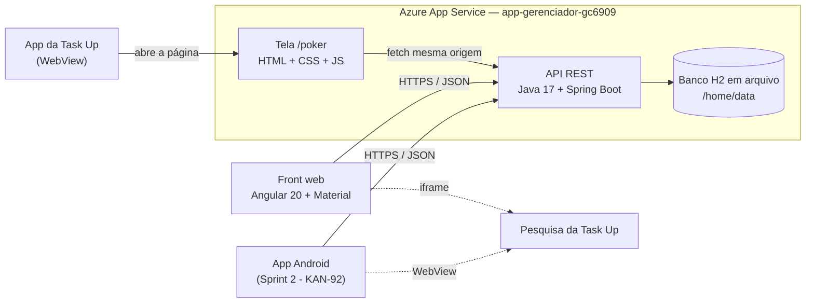
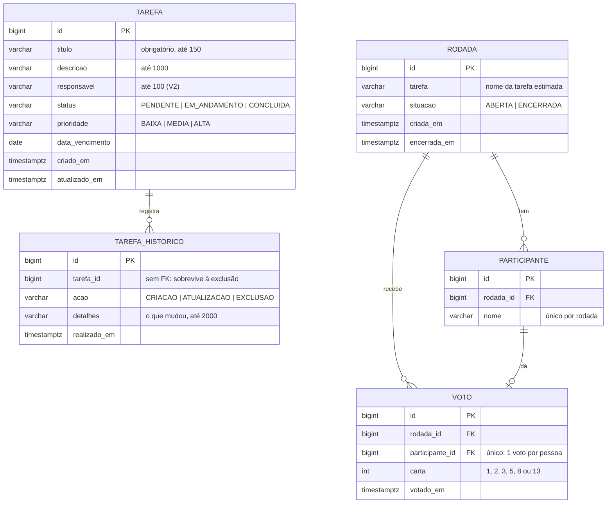

# Modelagem técnica — Gerenciador de Tarefas (Smart Group)

Documento da KAN-40. Descreve a arquitetura, o banco, a API e como cada parte se conecta na Sprint 2.

## 1. Arquitetura



- **Uma API só** atende a web, o app Android e a tela do Planning Poker. Todos usam o mesmo banco.
- URL pública: `https://app-gerenciador-gc6909.azurewebsites.net`
- O schema do banco é versionado com **Flyway** (`api/src/main/resources/db/migration`).
- Erros seguem o padrão **Problem Details (RFC 9457)**: `{ title, status, detail, erros: [{campo, mensagem}] }`.

### Camadas do backend

| Camada | Pacote | Papel |
|---|---|---|
| Controller | `*.controller` | Recebe HTTP, valida a entrada (`@Valid`) e devolve DTOs |
| Service | `*.service` | Regras de negócio e transações |
| Repository | `*.repository` | Acesso ao banco (Spring Data JPA, Criteria API) |
| Domain | `*.domain` | Entidades JPA e enums |
| DTO | `*.dto` | Contratos de entrada e saída da API (records) |

Módulos: `tarefa` (CRUD e histórico), `dashboard` (HU07) e `poker` (KAN-93).

## 2. Banco de dados



| Migration | Conteúdo |
|---|---|
| `V1__criar_tabela_tarefa.sql` | Tabela `tarefa` (Sprint 1) |
| `V2__adicionar_responsavel_tarefa.sql` | Coluna `responsavel` |
| `V3__criar_tabela_tarefa_historico.sql` | Histórico de alterações (HU05) |
| `V4__criar_tabelas_planning_poker.sql` | `rodada`, `participante`, `voto` (KAN-93) |

## 3. Endpoints

Base: `/api/v1`. Documentação interativa em `/swagger-ui.html`.

### Tarefas

| Método | Rota | Descrição |
|---|---|---|
| GET | `/tarefas?page=0&size=10&sort=criadoEm,desc&status=&termo=&responsavel=` | Lista paginada e ordenada (HU06) |
| GET | `/tarefas/{id}` | Busca uma tarefa |
| POST | `/tarefas` | Cria (201 + `Location`) |
| PUT | `/tarefas/{id}` | Edita (HU03) |
| DELETE | `/tarefas/{id}` | Exclui (204) (HU04) |
| GET | `/tarefas/{id}/historico` | Histórico de alterações, mais recente primeiro (HU05) |

Corpo de POST/PUT:

```json
{
  "titulo": "Estudar Spring",
  "descricao": "Capítulo 3",
  "responsavel": "Gabriel",
  "status": "PENDENTE",
  "prioridade": "ALTA",
  "dataVencimento": "2026-11-30"
}
```

Resposta da lista:

```json
{ "conteudo": [ { "id": 1, "titulo": "...", "responsavel": "...", "status": "PENDENTE", "...": "..." } ],
  "pagina": 0, "tamanho": 10, "totalElementos": 1, "totalPaginas": 1 }
```

Campos aceitos em `sort`: `titulo`, `responsavel`, `status`, `prioridade`, `dataVencimento`, `criadoEm`, `atualizadoEm`.

### Dashboard (HU07)

| Método | Rota | Descrição |
|---|---|---|
| GET | `/dashboard?responsavel=&status=&dataInicio=yyyy-MM-dd&dataFim=yyyy-MM-dd` | Métricas agregadas |

Métricas (KAN-83): total, concluídas, % concluídas, vencidas (não concluídas com vencimento antes de hoje),
criadas nos últimos 7 dias, contagem por status, por prioridade e por responsável.

- Agregações feitas no banco com `COUNT` / `GROUP BY` (KAN-84).
- Período filtra pela data de criação, com fim inclusivo (KAN-85).
- Cache em memória por filtro e por dia, limpo a cada criação, edição ou exclusão de tarefa (KAN-86).
- Cada acesso gera uma linha no logger `acesso.dashboard` com IP, User-Agent e filtros (KAN-89).

### Planning Poker (KAN-93)

| Método | Rota | Descrição |
|---|---|---|
| POST | `/rodadas` `{ "tarefa": "Tela de login" }` | Abre uma rodada |
| GET | `/rodadas` | 20 rodadas mais recentes |
| GET | `/rodadas/{id}` | Situação: total de votos e quem votou, **sem** as cartas |
| POST | `/rodadas/{id}/votos` `{ "participante": "Ana", "carta": 5 }` | Vota (201) |
| POST | `/rodadas/{id}/encerrar` | Encerra e devolve o resultado |
| GET | `/rodadas/{id}/resultado` | Resultado (só depois de encerrar) |

Regras (KAN-106):

- Um voto por participante (nome, sem diferenciar maiúsculas). Repetir devolve **409** “Seu voto já foi registrado nesta rodada.”
- Só cartas 1, 2, 3, 5, 8 e 13 (outra carta → **400**).
- Votos escondidos enquanto a rodada está aberta (resultado → **409**).
- No encerramento: média com uma casa, carta mais votada (no empate, a maior) e divergência quando a menor
  e a maior carta estão a mais de duas posições de distância na sequência (ex.: 2 e 8).
- Não encerra rodada sem votos.

Tela: `https://app-gerenciador-gc6909.azurewebsites.net/poker` (lista e abre rodadas) e
`/poker?rodada={id}` (votação). Atualiza sozinha a cada 3 segundos e avisa quando está sem internet.

## 4. Front web (Angular)

| Rota | Tela |
|---|---|
| `/tarefas` | Lista com busca, filtro por responsável e status, ordenação e paginação. No celular vira cartões (sem rolagem lateral) |
| `/tarefas/nova` | Cadastro com validação |
| `/tarefas/:id/editar` | Edição + histórico de alterações |
| `/dashboard` | Indicadores e gráficos de barras com filtros |
| `/avaliar` | Pesquisa de satisfação da squad parceira (Task Up), embutida em iframe |

### Troca de telas entre as squads (WebView)

| Direção | URL |
|---|---|
| Smart Group entrega para a Task Up | `https://app-gerenciador-gc6909.azurewebsites.net/pesquisa` (pesquisa de satisfação do Gerenciador de Tarefas) |
| Task Up entrega para a Smart Group | `https://pesquisa-satisfacao-pf-h9dzbzdxf3etc5dv.brazilsouth-01.azurewebsites.net/pesquisa.html` (pesquisa de satisfação, KAN-102) |

A pesquisa que entregamos é servida pela própria API (`static/pesquisa`) e grava as respostas na tabela `avaliacao` (V5).
Endpoints: `POST /api/v1/avaliacoes` { notaGeral 1-5, facilidadeUso 1-5, recomendaria, funcionalidadeFavorita?, comentario? }
e `GET /api/v1/avaliacoes/resultado` (médias, % que recomendaria, distribuição das notas, funcionalidades e últimos comentários).
O Planning Poker (`/poker`) foi substituído pela pesquisa e não é mais entregue.

A URL da API fica em `front/src/environments/environment*.ts`.

## 5. Como rodar

```bash
# API local com H2 em memória (porta 8080)
cd api
./mvnw spring-boot:run -Dspring-boot.run.profiles=local
# testes
./mvnw test

# Front
cd front
npm install
npm start      # http://localhost:4200
```

Para o front usar a API local, troque `apiUrl` em `environment.development.ts` para `http://localhost:8080/api/v1`.

## 6. Publicar no Azure (KAN-109)

```powershell
az login
./infra/azure/deploy-backend.ps1 -SomentePublicar
```

O script recompila o `.jar` e publica no App Service existente. O Flyway aplica as migrations V2 a V4 sozinho
na primeira subida, sem apagar as tarefas que já existem.

CORS: a variável `CORS_ALLOWED_ORIGINS` (ou `app.cors.allowed-origins` no `application.yml`) define quem pode
chamar a API pelo navegador. A tela `/poker` é servida pela própria API (mesma origem) e o app Android não passa por CORS,
então só é preciso incluir ali a URL onde o front Angular for publicado.
